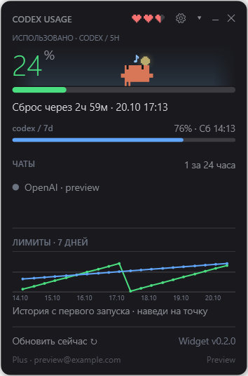
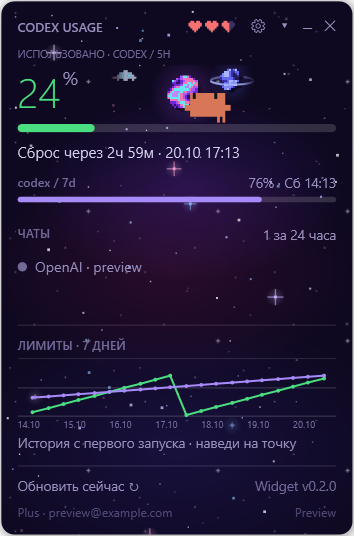
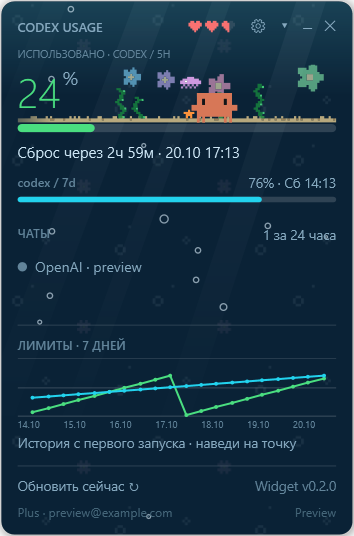
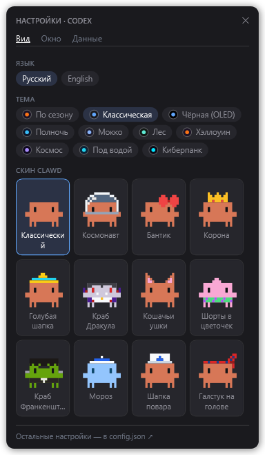

# Codex Usage Widget

Виджет для **OpenAI Codex** под Windows — порт [Clawd Usage WinWidget](https://github.com/Enhed/clawd-usage-winwidget), исходного виджета для **Claude Code**. Маскот Clawd, скины, темы и стиль настроек сохранены; данные о лимитах и работе подключены к Codex.

[English](README.md) · [Скачать ZIP](https://github.com/Enhed/codex-usage-widget/archive/refs/heads/main.zip) · [Оригинал для Claude](https://github.com/Enhed/clawd-usage-winwidget)



## Возможности

- Все возвращённые Codex окна лимитов: использованные проценты, полоски и местное время сброса. Иконка в трее.
- Clawd **бегает во время работы Codex**, дремлет через **10 минут** без обновлений чатов, засыпает через **20 минут**. Новое обновление чата будит его после ближайшей проверки. Наведение мыши не сбрасывает таймер.
- Десять вариантов темы, включая анимированные «Космос», «Под водой», «Хэллоуин» и «Киберпанк»; скины с предпросмотром при наведении.
- Настройки по аналогии с исходником: вкладки «Вид», «Окно», «Данные», цветные кнопки тем, карточки скинов, переключатели и кнопки «−/+». Изменения применяются сразу.
- Масштаб, прозрачность, окно поверх остальных, сохранение позиции с проверкой доступности монитора.
- Небо, погода, статус OpenAI, тариф и аккаунт, статистика токенов при поддержке сервисом.
- История лимитов за семь дней и проекты по числу недавно обновлённых чатов.
- Русский и английский интерфейс. PowerShell 5.1 и системные библиотеки Windows, без сторонних пакетов.

Чат с маскотом, задачи, запуск команд, напоминания, списки и советы по компьютеру в этот порт не включены. Самообновление исходного приложения также не используется.

## Запуск

1. Установить Codex CLI в PATH и войти через ChatGPT: `codex login`.
2. Скачать ZIP по ссылке выше и распаковать **всю папку**.
3. Дважды нажать `start-widget.vbs`.

Нужны Windows 10/11 и Windows PowerShell 5.1. Администратор не требуется. Используются существующая авторизация Codex и `CODEX_HOME`; настройки самого Codex не меняются.

Перемещение — за заголовок, шестерёнка — настройки, треугольник — подробности, минус — скрыть в трей, крестик — выход. ПКМ по маскоту — состояния, анимации и погода. Ручное обновление — из меню трея или подробностей.

## Темы и настройки

| Космос | Под водой |
| --- | --- |
|  |  |



## Данные

Крупное число — процент **использованного** первого доступного окна основного лимита Codex. Остальные окна показаны ниже. По умолчанию лимиты обновляются раз в минуту. При сбое сохраняются последние данные с пометкой «Устарело»; отсутствующие окна не заменяются нулём.

Лимиты, аккаунт и список недавних чатов читаются через [официальный протокол Codex App Server](https://learn.chatgpt.com/docs/app-server). Виджет не запускает ответы модели. При авторизации API-ключом лимиты подписки ChatGPT могут быть недоступны. Статистика токенов отображается только при поддержке сервисом.

Активность проверяется отдельно раз в пять секунд. В поддерживаемых установках системная библиотека Windows SQLite читает только идентификаторы, время и состояния выполнения из локальных баз `state_5.sqlite` и `thread_history_1.sqlite`. Тексты сообщений не читаются. Внутренние схемы могут измениться в будущих версиях Codex; при отсутствии баз используется доступная метаинформация App Server. Счётчик недавних чатов включает до 100 записей и не означает число работающих агентов.

Для погоды используются ipwho.is, Open-Meteo и резервный met.no. Отключается настройкой неба и погоды; свои координаты можно указать в `weatherLat` / `weatherLon`. Статус сервиса — общий статус OpenAI.

## Папки

```text
src/           приложение, клиент Codex и модули интерфейса/анимаций
ui/            XAML-разметка
assets/skins/  скины
data/          локальные настройки, история и журнал ошибок (не в Git)
tools/         проверки и диагностика
docs/          превью на демонстрационных данных
```

Настройки находятся в `data/config.json`, изменения файла подхватываются на лету. История собирается с первого запуска. Личные данные, логи и локальные резервные копии не публикуются. Обновление — вручную: закрыть виджет и заменить файлы приложения, сохранив `data/`.

## Проверки

```powershell
# Реальные лимиты без открытия окна
powershell.exe -NoProfile -ExecutionPolicy Bypass -File widget.ps1 -Check
# Синтаксис, лимиты, настройки, анимации и сохранность данных
powershell.exe -NoProfile -STA -ExecutionPolicy Bypass -File tools/smoke.ps1
# Время и состояния активности без вывода содержимого чатов
powershell.exe -NoProfile -ExecutionPolicy Bypass -File tools/check-activity.ps1
```

Превью закрываются автоматически и используют отдельные тестовые данные. Файлы PowerShell — UTF-8 с BOM, CRLF, синтаксис 5.1. Ошибки записываются в `data/widget-error.log`.

## Авторство и лицензия

Основано на **[Clawd Usage WinWidget](https://github.com/Enhed/clawd-usage-winwidget)**, автор — **Venger Sergey**. Маскот, скины, темы и значительная часть визуального кода перенесены из исходного проекта. Это порт виджета для Claude Code под Codex, а не официальный продукт OpenAI.

Лицензия MIT; исходное уведомление об авторских правах и текст лицензии сохранены в [LICENSE](LICENSE).
